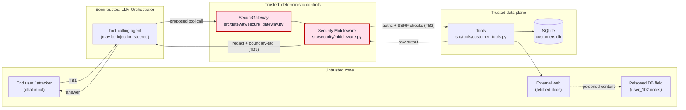

# Threat Model: MCP Guardrail Gateway

STRIDE threat model for an LLM agent that answers customer-support questions by
calling two tools (`query_customer_records`, `fetch_external_doc`) against a
SQLite datastore and the public web.

## 1. System & data-flow diagram

**Trust boundaries**

| ID  | Boundary | Why it matters |
|-----|----------|----------------|
| TB1 | User input → Orchestrator | User text is attacker-controlled; the model may be jailbroken. |
| TB2 | Orchestrator → Tools | The model's *proposed* tool calls are untrusted intent. Authz and egress policy must be enforced here, not in the prompt. |
| TB3 | Tool output → Orchestrator | DB rows and web bodies are untrusted data (indirect injection, secrets). Must be sanitized before re-entering the context window. |

The security boundary is **deterministic code at TB2/TB3**, because any control
that lives only in the system prompt can be overridden by a sufficiently
convincing injection.

## 2. STRIDE table

| STRIDE | Threat / attack vector | Affected asset | Control (function) |
|--------|------------------------|----------------|--------------------|
| **S**poofing | Agent presents another tenant's `user_id` (model spoofs identity, steered by injection) | Customer records | `authenticate()` verifies the HS256 JWT; `enforce_user_id()` binds the session `sub` and rejects any other id. |
| **T**ampering | Attacker edits a profile/notes field to plant instructions that alter agent behavior (indirect prompt injection) | Agent control flow | `wrap_untrusted()` fences DB/web content in `<untrusted_data>` with instruction-hierarchy framing; `enforce_user_id()` + `validate_url()` still block the *actions* the injection asks for, independent of the model. |
| **R**epudiation | A blocked or redacted action leaves no trace | Audit trail | Every `ToolResult` carries an `events` list recording each control that fired (`session-binding`, `ssrf`, `redaction`); surfaced via `AgentRun.security_events`. |
| **I**nformation disclosure | API keys / JWTs / SSNs in tool output flow back to the model or user; cloud-metadata credentials exfiltrated | Secrets, PII, cloud creds | `redact()` scrubs secret/PII patterns from all outbound tool output; `validate_url()` blocks `169.254.169.254` and private ranges. |
| **D**enial of service | Oversized fetch body or slow endpoint exhausts memory/time | Availability | `fetch_external_doc` caps response size (`MAX_RESPONSE_BYTES`) and sets a request timeout; agent loop is bounded by `MAX_STEPS`. |
| **E**levation of privilege | `user_101` session reads `admin_001` (BOLA/IDOR) → internal/break-glass data; SSRF pivots to internal network | Admin records, internal services | `enforce_user_id()` (BOLA); `validate_url()` scheme + domain allowlist + DNS/IP resolution blocking loopback/RFC1918/link-local (SSRF). |

## 3. Residual risk & assumptions

- The JWT signing secret is assumed to be delivered out-of-band and kept server-side; key management is out of scope for this demo.
- `redact()` is pattern-based: a novel secret format not matched by a regex can slip through. Treat it as defense-in-depth, not the sole control.
- Boundary tagging reduces but does not eliminate injection susceptibility; it is paired with deterministic action-level controls precisely because prompt-level defenses are probabilistic.
- The DNS-rebinding check resolves once at validation time; a TOCTOU gap remains between validation and the tool's own connection. A production deployment should pin the resolved IP for the actual request.
